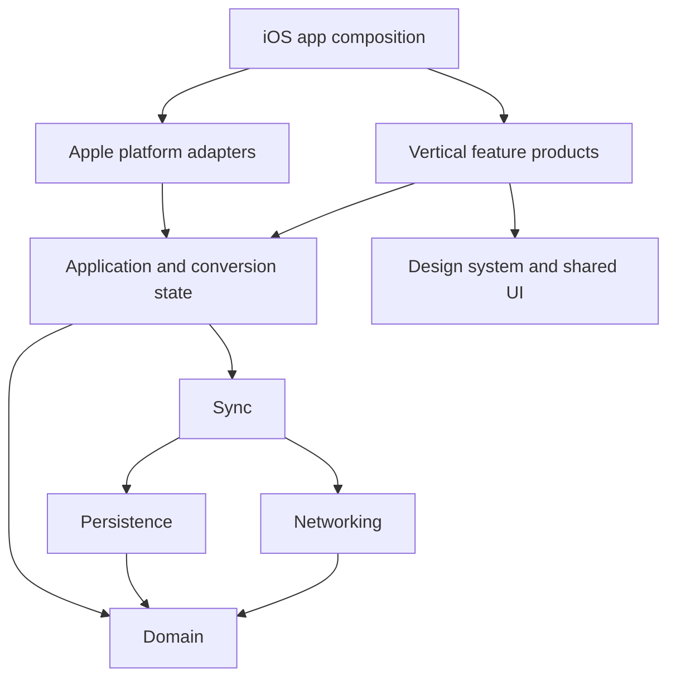

# TripSplit architecture

Architecture decisions recorded on 31 October 2026. Native SwiftUI for iPhone v2 (Pop) and iPhone Duo; strict TypeScript on Cloudflare Workers; explicit offline synchronisation; Sign in with Apple. Visual references are the supplied TripSplit v2 Pop and iPhone Duo handoff. The HTML is visual reference, not production code or authoritative financial arithmetic.

## Package architecture

The 1 November 2026 re-architecture follows KeepFresh's local Swift packages, feature products and thin application composition. The reusable core has no dependency on SwiftUI, UIKit, MapKit presentation or a particular application's bundle. The existing iOS interface remains the first consumer; watchOS and macOS can compose the shared services with their own interfaces later. iPadOS uses the existing adaptive iOS app.

| Package | Responsibility |
| --- | --- |
| `TripSplitDomain` | Codable models, accounting, civil dates, destination metadata, transport values and local drafts |
| `TripSplitInfrastructure` | Separate networking, persistence and sync products; explicit transport, storage and credential boundaries |
| `TripSplitApplication` | Observable application coordination and independently usable conversion state |
| `TripSplitFeatures` | Design system, shared presentation and separate vertical UI products for trips, expenses, conversion, onboarding, account and globe |
| `apple/ios/TripSplit` | App lifecycle, platform configuration, assets and root navigation composition |

Dependencies point from features and application coordination toward the core. Domain does not import a design system; networking does not discover configuration from `Bundle.main` or reach into a global signed-in account. The app supplies configuration and services. Each feature declares the products it actually uses. Apple sign-in presentation, map presentation and haptics stay at the platform edge.

The API follows KeepFresh's typed Hono route definitions and schema modules, using `OpenAPIHono`, `createRoute` and `@hono/zod-openapi`. Bun installs locked dependencies and runs development, validation and release scripts. Requests still execute on Cloudflare Workers; Durable Objects and D1 retain their existing identities and responsibilities. Hono changes the HTTP composition layer, not the sync or financial protocol. There is no new public API-documentation endpoint.

### Migration plan and acceptance

1. Record the existing app/API contracts and preserve an actual build-5 SQLite store, including its document hashes, before moving code.
2. Extract Foundation domain and transport values, then networking, persistence and sync. Preserve stored field names, document keys, SwiftData entity schema, session Keychain identifiers and operation payloads.
3. Extract observable application state and vertical SwiftUI products. Keep app lifecycle and root navigation in the iOS shell, and load package resources through their owning bundles.
4. Rename `backend/` to `api/`, adopt Bun's frozen lockfile and compose typed Hono routes. Preserve bounded request parsing, error envelopes, middleware order, maintenance behaviour, WebSocket responses and scheduled cleanup.
5. Run package tests and native iOS tests, compile the reusable products for watchOS and macOS, reopen a legacy store and update the installed simulator app in place. Verify existing trips, drafts and pending operations survive.
6. Update documentation, generator paths and CI; review the diff; deliver the source through a PR and the existing Cloudflare/internal TestFlight workflows. A new Watch or Mac UI is a separate feature, not part of this migration.

New features should add a focused target/product, declare its dependencies and expose a small entry point for app composition. Share business rules and services first; share presentation only when the destination platform supports the interaction. Avoid adding a dependency from a core product back to application or feature code.

### Repository boundaries and API contracts

All Apple applications and Swift packages live under `apple/`. The current iPhone/iPad shell is `apple/ios/`; reusable packages are `apple/Packages/`. Future watchOS and macOS shells can sit alongside `ios/` and consume those same local products. `api/` owns server code, and a future `web/` application will be a sibling. Shared repository documentation and data-generation tools remain at the root. The folder name is a project convention, not an Apple requirement; [Apple's guidance](https://developer.apple.com/documentation/xcode/organizing-your-code-with-local-packages) supports local packages in the same repository as their consuming app.

`api/src/schemas/` is the authoritative runtime and wire-shape definition. `api/src/types/contract.ts` infers TypeScript types from those schemas rather than maintaining duplicate interfaces. `api/contracts/openapi.json` is generated from the Hono route definitions and checked for drift in CI. The API does not need a separately maintained root `contracts/` package.

[Hono RPC](https://hono.dev/docs/guides/rpc) shares TypeScript types with TypeScript clients; it is not a Swift contract. [Hono's Zod/OpenAPI integration](https://hono.dev/examples/zod-openapi) gives non-TypeScript consumers a portable schema. [Swift OpenAPI Generator](https://github.com/apple/swift-openapi-generator) can consume that artifact when we introduce generated transport adapters. Existing Swift Codable transport and persisted domain models remain stable during this layout migration; generated network types must not become the persistence schema implicitly.

Schema validation does not replace protocol semantics or accounting examples. `api/docs/protocol.md` records operation identity, retries, authentication and sync behaviour. `api/contracts/fixtures/money-examples.json` verifies matching Swift/TypeScript arithmetic; `api/src/data/currencies.json` owns the ISO currency precision metadata. Swift tests and the destination generator read these canonical API-owned files. The running app uses bundled/generated Swift resources and does not depend on the API source tree being present.

## Product rules

- Trips have a reporting currency and a whole-trip budget. Expenses have an original amount/currency, payer and a nonempty subset of travellers receiving equal shares. The payer need not be a beneficiary.
- Planned expenses contribute to expected cost, not debt. Paid expenses contribute to actual cost and balances. A repayment reduces debt without increasing spending. Marking planned as paid updates the same expense.
- Store money as integer minor units encoded as decimal strings in JSON. Use the shared official ISO 4217 table in `api/src/data/currencies.json` for accounting precision; display libraries can use different conventions. FX rates are positive decimal strings. Round half-up to the reporting currency's minor unit, then distribute split remainders deterministically by sorted traveller ID. Never use floating-point arithmetic for ledger values.
- Missing conversion rates mean an incomplete total, never a zero-cost expense. Keep the original amount, conversion source, effective rate date and whether a rate is a reference estimate or manually entered. Paid conversions stay fixed unless explicitly edited. Card charges can be entered as an explicit reporting-currency amount.
- Label total/person as an average. Calculate the current traveller's share from actual allocations. Preserve pennies in balances; the prototype's half-unit settlement threshold is inappropriate.
- Trip dates are civil `YYYY-MM-DD` dates, not UTC instants. Stops have ordered nights; days include the departure day and final return day (`sum(nights)+1`). Stable IDs attach expenses to days/legs. Changing itinerary dates or stops must not silently move or discard financial records.
- Travellers are trip-local identities and can exist without accounts. Membership links a verified account to an existing traveller through an organiser-issued invite, never by matching a name. Members can edit expenses with history. Owner controls membership, itinerary and budget. Financially referenced travellers are archived rather than erased.
- Repayments record money transferred elsewhere. No payment processing in v1.

## Ownership and storage

The Worker authenticates requests and routes them to one SQLite-backed `TripRoom` Durable Object per trip ID. The TripRoom is authoritative for the trip, membership, invites, financial records, tombstones, monotonic revision, accepted operation receipts and history. Related writes run in one SQLite transaction without external I/O inside it. Membership is checked at every operation/read and before sending live updates.

D1 stores users, Apple identity associations, device sessions, one-use auth challenges, immutable FX quotes and a user-to-trip discovery index. The index is a projection: a persisted TripRoom outbox updates it with retries/alarms and revision-aware upserts. It never grants access. A trip listing resolves authoritative membership before disclosing a trip. Keep sessions hashed; keep secrets in Worker secret bindings. Do not log tokens or private financial payloads.

TripRoom tables include `trip`, versioned `entities` (travellers, expenses and repayments), `members`, `stops`, `days`, `legs`, `invites`, `operation_receipts`, `changes` and `directory_outbox`. Per-entity JSON holds validated record fields; SQL keys and transactions enforce identity/revision boundaries. Derive a current JSON snapshot for transport; never replace the whole trip blindly on each edit.

Suggested D1 tables: `users`, `apple_identities`, `auth_challenges`, `sessions`, `user_trips`, `fx_quotes`. User identity is Apple's verified issuer/subject, not email. The server generates its own user ID. Session refresh rotates credentials; logout and account deletion revoke sessions.

## Offline and recovery

The app persists a confirmed snapshot, pending operations and drafts. Persist an edit and its outbox operation together before showing success. An operation ID stays unchanged across retries and device backup restoration. Maintain a device/session identity separately from operation identity.

The server atomically checks operation receipt, current membership, expected entity revision and invariants; commits changes and receipt; increments the trip revision; then notifies connected devices. Reusing an operation ID with different content is rejected. Concurrent independent expense additions compose. Competing edits return a conflict with current state; retain the local draft for resolution. Use desired state (`status = paid`), never a replay-sensitive toggle command.

Transport uses bounded batches and versioned snapshots in v1. A client sends its last acknowledged revision; changed responses include a complete consistent snapshot. This avoids missing deletes and partial graph states. The protocol can add incremental changes later without changing operation identities. WebSocket messages are refresh hints; foreground/reconnect sync is mandatory. If history has been compacted, return a full snapshot. Never infer that an old pending command was rejected just because its receipt was pruned; retain receipts/tombstones for the trip's lifetime or reject stale sync epochs explicitly.

Use SwiftData only for local persistence, explicitly disabling automatic CloudKit sync (`cloudKitDatabase: .none`). Normal device backups may include local data, drafts and pending operations. Exclude disposable caches, not the only copy of user-created data. Restored snapshots are reconciled with Cloudflare before uploading stale edits. Bind restored data to the authenticated account. Session credentials belong in nonsynchronising, device-bound Keychain storage; a replacement device signs in again. Device backup does not guarantee recovery of changes after its last successful snapshot.

Server recovery is separate: document and test D1 Time Travel and Durable Object point-in-time restoration, including resetting sync epochs after a server rollback so old client cursors cannot suppress recovery.

## Authentication and invitations

Local use and onboarding precede sign-in. Creating/syncing a cloud trip or accepting an invite requires Sign in with Apple. The Worker issues a short-lived, one-use nonce challenge, verifies Apple's signed token (issuer, audience, expiry, nonce and key), exchanges the authorisation code as required, and issues device sessions. Identity verification fails closed if Apple configuration is missing. Do not ship a development login endpoint.

Invite links are created by the owner for an existing traveller, have a cryptographically random secret stored hashed, expire and can be revoked. Accept requires authentication and atomically consumes the invite/link membership. Treat links as bearer secrets and omit them from logs. Native universal links use an explicitly configured associated domain and Apple application identifier; no guessed team ID or fake live URL.

## Native presentation

One app state owns the navigation path `Trips -> Trip -> Day`, sheet drafts and onboarding; the globe feature owns its map camera. Layout changes only presentation. Closed uses the current screen; wide pairs its parent with it; tent reflows the current task. Keep stable view identity, native toolbars, tab bars, sheets and accessibility. iOS 26 baseline; gate Duo APIs to their actual SDK availability (27.1 where required). Build with Xcode 27.1 or later and verify the supported simulator/device poses.

Implement all designed screens: trips/current/upcoming/past, trip overview and balances, day and travel legs, expense editing, quick convert, seven-step onboarding, globe and the boarding-pass component. Pop is the selected direction; Night informs dark mode. Use Reduce Motion equivalents and Dynamic Type. Seed content is opt-in demo/preview data only, not a new user's trips.

## Verification and delivery

Swift and TypeScript share the money examples under `api/contracts/fixtures/`; API schemas generate the portable OpenAPI contract. Test rounding, unequal beneficiary sets, repayments, unresolved conversions, authorisation, duplicate/reordered commands, conflicts, offline restart and backup restoration. Run native builds and exercise iPhone/Duo flows with screenshots/video. Keep credentials and generated builds outside git.

`apple/ios/` contains the native app shell; `apple/Packages/` contains shared Swift products; `api/` contains the Worker, storage implementation and canonical contracts. Update the API schema and both consumers together when changing that boundary.
